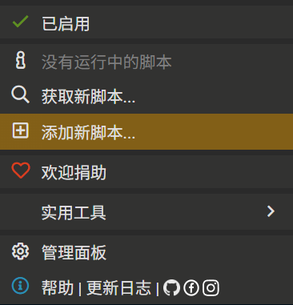
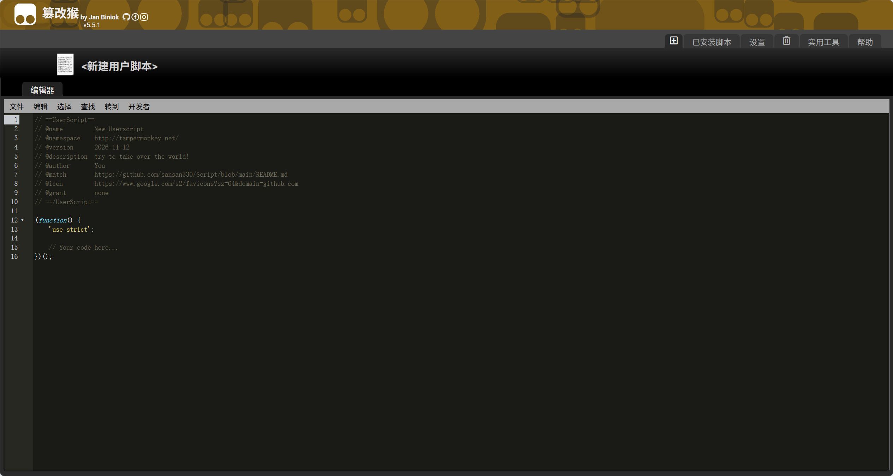
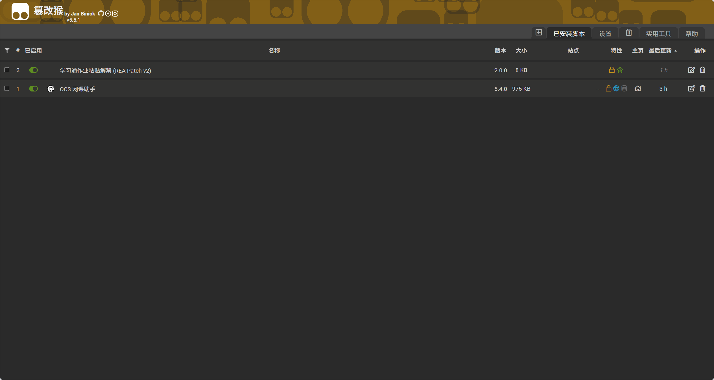

# 学习通作业粘贴解禁 (REA Patch)

> 解除超星学习通作业编辑框「只能录入不能粘贴」限制的浏览器脚本。
> 支持油猴（Tampermonkey）直接安装，也提供 Playwright 自动注入启动器。

---

## 背景

学习通作业页面并不是靠简单的 `onpaste="return false"` 拦截粘贴，而是通过两套脚本逻辑：

| 编辑器类型 | 拦截方式 |
|-----------|----------|
| 富文本题（UEditor） | 为每个编辑器实例注册 `beforepaste` 监听器，把待粘贴内容 `html.html` 置空，并弹出「只能录入不能粘贴!」 |
| 编程题（CodeMirror） | 注册 `beforeChange` 监听器，检测到 `change.origin === 'paste'` 时调用 `change.cancel()` 取消本次粘贴 |

因此只修改 `allowPaste` 配置是无效的。本项目脚本针对上述两个真实拦截点做定向处理。

---

## 特性

- 拦截 UEditor `beforepaste` 限制监听器的注册，并清理已注册的限制器
- 覆盖页面全局的 `myEditor_paste` 清空函数
- 剔除 CodeMirror 中调用 `change.cancel()` 的 `beforeChange` 监听器
- 恢复被禁用的图片粘贴（`disablePasteImage`）
- 常驻监听 DOM 变化，编辑框动态加载后自动补丁
- 提供手动补救入口 `window.__reaUnblockPaste()`

---

## 安装与使用

### 方式一：篡改猴（Tampermonkey）—— 推荐，最简单

#### 第 1 步：安装篡改猴

在浏览器扩展商店安装 Tampermonkey（篡改猴），安装后确认扩展图标处于「已启用」状态。

#### 第 2 步：点击「添加新脚本」

点击浏览器右上角的篡改猴图标，在菜单中选择 **添加新脚本...**



#### 第 3 步：粘贴脚本代码

页面会打开「新建用户脚本」编辑器，里面是一段默认模板。**全选删除**（`Ctrl + A` → `Delete`），然后粘贴 [`chaoxing-patch.user.js`](./chaoxing-paste-unlock/chaoxing-patch.user.js) 的完整内容。



#### 第 4 步：保存

按 `Ctrl + S`，或点击顶部菜单 **文件 → 保存**。

#### 第 5 步：确认已启用

打开篡改猴的「管理面板」，列表中应出现 **学习通作业粘贴解禁 (REA Patch v2)**，左侧开关为绿色即表示已启用。



完成后打开或刷新学习通作业页面，直接在答题框中 `Ctrl + V` 即可。

### 方式二：Playwright 启动器

适合脚本被插件禁用、或需要排除油猴干扰时做对比验证。

```bash
cd chaoxing-paste-unlock
npm install
node chaoxing-patch.mjs
```

启动后会打开一个独立的 Chrome 实例，所有页面与 iframe 在加载前自动注入补丁，正常登录并进入作业页即可。

---

## 验证是否生效

打开浏览器控制台（F12 → Console），应看到：

```
[REA-Patch v2] 已启动：针对 beforepaste 清空 + CodeMirror change.cancel 拦截
```

成功解除限制时会额外输出：

```
[REA-Patch] 已解除 N 处粘贴限制
```

也可以在控制台手动执行：

```javascript
window.__reaUnblockPaste()   // 返回本次清理的拦截器数量
```

---

## 常见问题

**Q：脚本已启用，粘贴仍然无效？**

检查控制台是否输出 `[REA-Patch v2] 已启动`。

- 没有输出：脚本没有注入当前页面，确认脚本已启用、域名匹配，并已刷新页面
- 有输出但返回 `0`：编辑器可能在跨域 iframe 中，或尚未创建，先点击一下答题框再执行 `window.__reaUnblockPaste()`

**Q：`.mjs` 和油猴脚本有什么区别？**

两者使用同一份补丁逻辑。`.mjs` 只是读取 `chaoxing-patch.user.js` 并在启动时注入，用于隔离验证，日常使用油猴脚本即可。

---

## 文件结构

```
Script/
├── README.md                    # 项目说明（本文件）
├── docs/images/                 # 安装步骤截图
│   ├── tampermonkey-menu.png
│   ├── tampermonkey-editor.png
│   └── tampermonkey-installed.png
└── chaoxing-paste-unlock/
    ├── chaoxing-patch.user.js   # 篡改猴脚本（核心补丁逻辑）
    ├── chaoxing-patch.mjs       # Playwright 启动器，复用上面的脚本
    └── package.json             # 依赖：playwright-core
```

---

## 免责声明

本项目仅用于个人学习、无障碍使用及前端技术研究，请勿用于违反所在学校或平台规定的用途。使用产生的任何后果由使用者自行承担。
